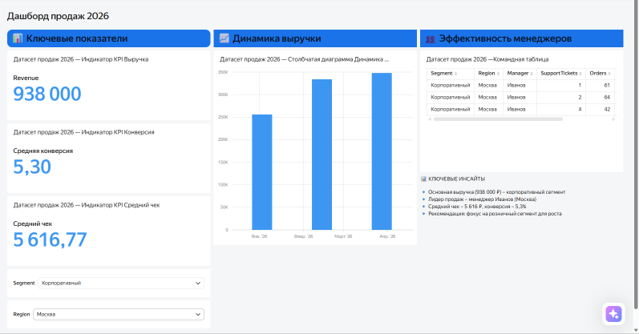

# 📊 Дашборд по анализу продаж в Yandex DataLens

Этот проект демонстрирует навыки создания интерактивных дашбордов для бизнес-аналитики. Дашборд позволяет в реальном времени отслеживать ключевые показатели эффективности отдела продаж интернет-магазина.

## 🎯 Задача
Разработать инструмент для мониторинга ключевых метрик отдела продаж, чтобы руководитель мог быстро оценивать ситуацию, видеть тренды и принимать решения на основе данных.

## 📊 Данные
* **Источник:** CSV-файл с 15 записями о продажах.
* **Период:** Январь – апрель 2026 года.
* **Содержание:** Дата, сегмент (корпоративный/розница), менеджер, регион, выручка, количество заказов, конверсия, затраты, количество обращений в поддержку.

## 🛠️ Инструменты
* **Yandex DataLens:** Визуализация данных, создание дашбордов.
* **Обработка данных:** Создание вычисляемых полей (средний чек, конверсия).
* **Markdown:** Оформление документации.

## 📈 Ключевые возможности дашборда
* **3 KPI-индикатора:** Общая выручка, средний чек, конверсия.
* **Динамика выручки:** Столбчатая диаграмма по датам.
* **Детальная таблица:** Эффективность каждого менеджера с показателями.
* **Интерактивные фильтры:** Возможность просмотра данных в разрезе сегмента и региона.
* **Ключевые выводы:** Текстовый блок с главными инсайтами.

## 🔗 Ссылка на дашборд
[Посмотреть дашборд в Yandex DataLens](https://datalens.yandex/your-dashboard-link)

## 💡 Основные выводы
* Основная выручка (938 000 ₽) формируется за счёт корпоративного сегмента.
* Лидер по продажам — менеджер Иванов (Москва).
* Средний чек стабилен (≈ 5 600 ₽), конверсия ≈ 5,3%.
* Есть потенциал для роста в розничном сегменте.

